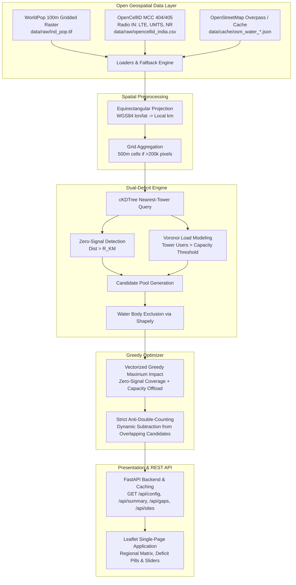

# Rural Connectivity & Capacity Gap Mapper (SW-27) 📡

An end-to-end geospatial web application implementing the **DoT (Department of Telecommunications) Audit & Open Geospatial Framework** (WorldPop 100m, OpenCellID 4G/5G NR, OpenStreetMap) to model and optimize both **Zero-Signal Tribal Blackspots** and **High-Population Capacity Bottlenecks** across rural India.


---

## 🌟 The Dual-Deficit Classification Model

In contrast to conventional single-metric coverage models, this application operationalizes the two distinct classifications of rural connectivity deficits identified in DoT audits:

1. **🔴 Zero-Signal Blackspots (Absolute Coverage Deficit)**:
   - **40 lakh people across 11,372 villages** in India completely lack 4G connectivity (~46% Scheduled Tribe population).
   - Characterized by rugged terrain, dense forest canopies, and hill shadow zones.
   - Benchmark Presets: **Malkangiri & Koraput (Odisha)**, **South Garo Hills (Meghalaya)**, **Bastar & Bijapur (Chhattisgarh)**, **Jawadhu Hills (Tamil Nadu)**, and **MM Hills (Karnataka)**.

2. **🟠 Capacity & Congestion Bottlenecks ("The Congested Rural Belt")**:
   - In the Indo-Gangetic plains and Terai, signal technically reaches habitations, but a single macro tower serves **10,000 to 15,000+ residents**.
   - Causes severe data contention, indoor dead zones, and bandwidth collapse.
   - Lowest rural teledensity in India: **Bihar (~42–43%)**, **Eastern Uttar Pradesh Terai (~48–51%)**.
   - Benchmark Presets: **Sitamarhi & Sheohar (Bihar)** and **Shravasti & Bahraich (UP Terai)**.

---

## 📐 System Architecture & Workflow



---

## 🗺️ National Regional Matrix (Built-in Presets)

| State | District Preset | Primary Classification | Deficit Indicators |
|---|---|---|---|
| **Bihar** | Sitamarhi & Sheohar | **Capacity Bottleneck** | ~42–43% rural teledensity; >15k users/tower |
| **Odisha** | Malkangiri & Koraput | **Zero-Signal Tribal Blackspot** | 1,789 villages with 0 towers (#1 nationwide) |
| **Uttar Pradesh** | Shravasti & Bahraich | **Congested Terai Plain** | ~48% teledensity; high users-per-tower congestion |
| **Meghalaya** | South Garo Hills | **Topographic Shadow** | 26.4% villages with zero measurable signal |
| **Chhattisgarh** | Bastar & Bijapur | **Forest Tribal Dead Zone** | ST village exclusion; dense forest cover |
| **Tamil Nadu** | Jawadhu Hills & Dharmapuri | **Ghats Tribal Valley Gaps** | Malayali tribal hamlets shadowed by hill ridges |
| **Karnataka** | Chamarajanagar & MM Hills | **Forest-Fringe Reserve Gaps** | Soliga tribal settlements bordering protected reserves |
| **Rajasthan** | Barmer Rural | **Dispersed Desert Hamlets** | Dispersed dhans with highway tower clustering |

---

## 🚀 Quick Start Guide

### 1. Installation
```bash
cd rural-coverage-mapper
python -m venv .venv

# On Windows:
.\.venv\Scripts\activate
# On Linux / macOS:
# source .venv/bin/activate

pip install -r requirements.txt
```

### 2. Running the Application
```bash
uvicorn backend.main:app --host 127.0.0.1 --port 8000 --reload
```

Open your browser to: **[http://127.0.0.1:8000](http://127.0.0.1:8000)**

---

## 🧪 Automated Pytest Suite (19/19 Passing)

```bash
pytest tests/ -v
```

All 19 test cases verify:
- Dual-deficit metrics calculation (zero-signal + congestion).
- Deficit filtering (`all`, `zero_signal`, `congested`).
- Greedy optimizer never double-counts population.
- Monotonic non-decreasing coverage in $K$.
- Known ground-truth toy case.
- 5G NR, LTE, and UMTS radio overrides.
- Multi-district switching across all national benchmark regions.

---

## 📜 Attributions & Licenses

- **Department of Telecommunications (DoT)**: Rural mobile connectivity audits.
- **WorldPop Project**: High-resolution population data ([CC BY 4.0](https://creativecommons.org/licenses/by/4.0/)).
- **OpenCellID**: Cellular tower coordinates ([CC-BY-SA 4.0](https://creativecommons.org/licenses/by-sa/4.0/)).
- **OpenStreetMap**: Geographic boundaries and water bodies ([ODbL](https://opendatacommons.org/licenses/odbl/)).
